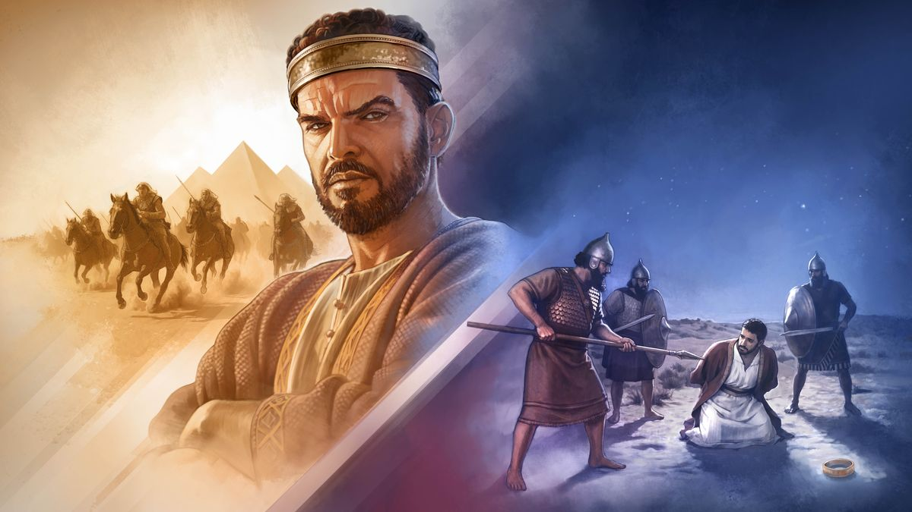

Nov 13, 2026

---

## INTRO [1 minuto]

Dalawampu't isang taóng gulang si Zedekias nang maging hari. Labing-isang taon siyang namahala sa Jerusalem. At sa mga taóng iyon, may propeta ni Jehova sa Jerusalem, si Jeremias. Ilang ulit pa ngang sumangguni sa kaniya ang hari para malaman ang mensahe ng Diyos.

Kaya hindi po kakulangan ng kaalaman ang naging problema ng haring ito. Alam niya ang tama. Pero malungkot ang naging wakas ng buhay niya. Kaya may paalala sa atin ang huling kabanata ng Jeremias: **Huwag Tularan si Zedekias.**

Susundan po natin siya sa Jeremias 52, sa tatlong yugto ng buhay niya: nang maging hari siya, nang maghimagsik siya, at nang maabutan siya ng mga Caldeo.

---

## 1 — Hindi ginawa ni Zedekias ang tama [2.5 minuto]

<mark class="green">**Nang maging hari siya.**</mark> Buksan po natin ang Jeremias kabanata 52, bersikulo 1 at 2. Pansinin po kung paano inilarawan ang buong paghahari niya.

*[Basahin ang Jeremias 52:1, 2]*

!!! quote "Jeremias 52:1, 2"
    "Si Zedekias ay 21 taóng gulang nang maging hari, at namahala siya nang 11 taon sa Jerusalem. Ang kaniyang ina ay si Hamutal na anak ni Jeremias ng Libna. Patuloy niyang ginawa ang masama sa paningin ni Jehova; tinularan niya ang lahat ng ginawa ni Jehoiakim."

**"Patuloy niyang ginawa ang masama sa paningin ni Jehova."** Sa madaling salita: **==Hindi ginawa ni Zedekias ang tama.==**

Bakit po kaya? Base sa referensya natin, si Zedekias ay **"isang haring duwag at sunud-sunuran sa kaniyang mga prinsipe."** Noong huling pagsalakay ng Babilonya, sumangguni siya kay Jeremias. Pero nang sabihan siya ng propeta na sumuko, hindi siya sumunod. Ipinakulong pa nga niya si Jeremias.

Pero pansinin po ito: sumasangguni pa rin siya. Sabi ng referensya, **palihim** niya itong ginagawa para hindi magalit ang mga prinsipe ng Juda. At inamin niya mismo kung bakit: natatakot siyang sundin ang Diyos **"dahil baka gawan siya ng masama ng mga tao."**

Kaya ano ang nakikita natin? Gusto niyang marinig ang sinasabi ni Jehova, pero mas natakot siya sa gagawin ng tao.

Parang pasyenteng paulit-ulit na nagpapatingin sa doktor, pero hindi naman iniinom ang gamot. Ang problema niya, hindi ang reseta. Ang problema, hindi niya ito sinusunod.

Puwede rin po itong mangyari sa atin. Alam natin ang sinasabi ng Bibliya. Naririnig natin ito sa mga pulong. Pero paano kapag nasa trabaho na tayo, o kasama ang mga kamag-anak na iba ang paniniwala, at alam nating pagtatawanan tayo kapag nanindigan tayo? Sa ganiyang sandali, kaninong sasabihin ang mas matimbang sa atin?

---

## 2 — Hindi tinupad ni Zedekias ang pangako niya kay Jehova [2 minuto]

<mark class="green">**Nang maghimagsik siya.**</mark> May isa pang ginawa si Zedekias. Tingnan po natin ang bersikulo 3 ng Jeremias 52. Pansinin po ang huling pangungusap.

*[Basahin ang Jeremias 52:3]*

!!! quote "Jeremias 52:3"
    "Dahil sa galit, hinayaan ni Jehova na mangyari sa Jerusalem at sa Juda ang mga bagay na ito hanggang sa mapalayas niya sila sa harapan niya. At si Zedekias ay naghimagsik sa hari ng Babilonya."

**"Naghimagsik sa hari ng Babilonya."** Sa unang tingin, parang pulitika lang ito. Pero bakit ito mabigat kay Jehova? Dahil may pangako sa likod nito. **==Hindi tinupad ni Zedekias ang pangako niya kay Jehova.==**

Base sa referensya natin, sumumpa si Zedekias **sa pangalan ni Jehova** na magpapasakop siya sa hari ng Babilonya. Obligado siyang tuparin iyon. Pero sa halip, humingi siya ng tulong sa Ehipto para makalaya sa pamatok ng Babilonya. At hindi ito nagtagumpay.

Sabi ng referensya: **"Seryosong bagay ang manumpa sa pangalan ni Jehova."**

Ano po ang itinuturo nito sa atin tungkol kay Jehova? Sabi ng referensya natin: **"Nakikinig din si Jehova kapag nangangako tayo."** Para sa Kaniya, seryoso ang mga panata natin, at dapat nating tuparin ang mga ito.

At ano po ang pinakamahalagang pangakong ginawa natin? Ang pag-aalay ng ating sarili kay Jehova. Ayon sa referensya, iyon ay **"isang taimtim na panata na paglilingkuran natin si Jehova nang walang kondisyon."**

Walang kondisyon. Ibig sabihin, hindi lang kapag madali. Hindi lang kapag walang kumokontra. Si Zedekias, nangako, pero para makalaya sa pamatok ng Babilonya, sa Ehipto siya humingi ng tulong. Tayo, kapag nahihirapan, kanino tayo humihingi ng tulong?

---

## 3 — Nagdusa si Zedekias dahil sa mga ginawa niya [2 minuto]

<mark class="green">**Nang maabutan siya.**</mark> Ano ang kinahinatnan ng lahat ng ito? Tingnan po natin ang Jeremias 52, bersikulo 8 hanggang 11. Pansinin po kung ano ang nangyari sa hari nang mapasok na ang lunsod.

*[Basahin ang Jeremias 52:8-11]*

!!! quote "Jeremias 52:8-11"
    "Pero ang hari ay hinabol ng hukbo ng mga Caldeo, at naabutan nila si Zedekias sa mga tigang na kapatagan ng Jerico. Nahiwalay siya sa hukbo niya at nagkawatak-watak ang mga ito. Hinuli nila ang hari at dinala siya sa hari ng Babilonya sa Ribla, sa lupain ng Hamat, at hinatulan siya nito. At pinatay ng hari ng Babilonya ang mga anak ni Zedekias sa harap niya, at pinatay rin nito sa Ribla ang lahat ng matataas na opisyal ng Juda. Pagkatapos, binulag ng hari ng Babilonya si Zedekias, iginapos siya ng kadenang tanso, dinala sa Babilonya, at ikinulong hanggang sa araw na mamatay siya."

**==Nagdusa si Zedekias dahil sa mga ginawa niya.==**

Pansinin po ang nawala sa kaniya: ang hukbo niya, ang mga anak niya, ang paningin niya, at ang kalayaan niya **"hanggang sa araw na mamatay siya."**

Kailangan po bang mangyari ito? Hindi. Sinabihan na siya ng propeta kung ano ang dapat gawin. Pero hindi siya sumunod. Ang kinatakutan niya ay ang gagawin ng tao. Pero ang talagang nagpahamak sa kaniya ay ang hindi niya pagsunod kay Jehova.

Kaya ano po ang aral? Hindi mabigat na pasanin ang pagsunod at ang pagtupad sa pangako. Sabi ng referensya natin, ito ay **"para sa ating ikabubuti,"** dahil ang ating katapatan ay aakay sa **"isang tiwasay na kinabukasan."**

---

## IMAGE [1 minuto]

**IMAGE CUE: picture.jpg**

Ngayon naman po, tingnan natin ang larawan.

<figure markdown="span">
  { width="100%" }
  <figcaption>Collage: Si Haring Zedekias at ang mga pangyayari bago siya hulihin. 1. Mga sundalong Ehipsiyo na nakasakay sa kabayo papuntang Jerusalem. 2. Hinuli ng mga Caldeo si Haring Zedekias.</figcaption>
</figure>

Ano po ba ang nakikita natin dito, mga kapatid at mga kaibigan? Sa gitna, si Haring Zedekias, suot ang korona niya. Sa kaliwa, mga sundalong Ehipsiyo na nakasakay sa kabayo. Iyan ang tulong na inasahan niya sa halip na tuparin ang pangako niya.

Sa kanan naman, gabi na. Nakaluhod si Zedekias, at napapalibutan siya ng mga sundalong Caldeo. At nasaan po ang korona niya? Nasa lupa na.

Hindi po nakatulong ang Ehipto. Ang makakatulong sana sa kaniya ay ang pagsunod kay Jehova.

*Salamat po sa picture.*

---

## CONCLUSION [1.5 minuto]

May tanong po para sa bawat isa sa atin: **==Ano ang dapat kong gawin para hindi ko matularan si Zedekias?==**

Ang sagot ng referensya natin: manindigan **"sa maliliit at malalaking pagsubok."** Halimbawa, kapag may nakikipag-flirt sa atin sa trabaho o sa paaralan, tinatanggihan natin ito. Kung tayo lang ang Saksi sa pamilya, humihingi tayo ng tulong kay Jehova. At araw-araw tayong nananalangin at nagbabasa ng Bibliya.

Nakita po natin ngayong gabi na **hindi ginawa ni Zedekias ang tama**, na **hindi tinupad ni Zedekias ang pangako niya kay Jehova**, at na **nagdusa si Zedekias dahil sa mga ginawa niya.**

Alam ni Zedekias ang tama, pero hindi niya ito ginawa. Kaya **huwag nating tularan si Zedekias.** Gawin natin ang alam nating tama, at tuparin natin araw-araw ang ipinangako natin kay Jehova. Para sa ating ikabubuti iyon.
