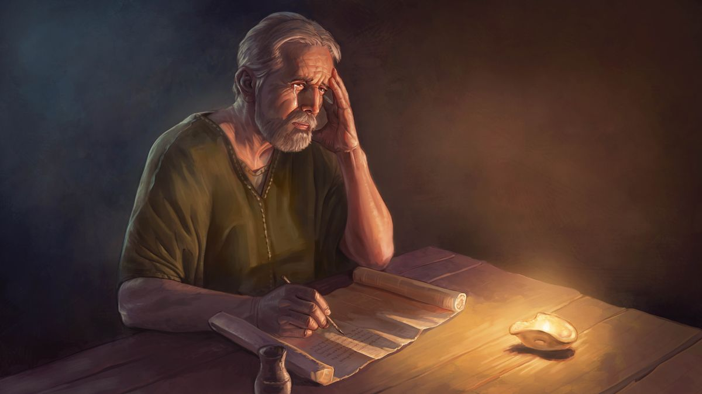

Nov 20, 2026

---

## VIDEO [3 minuto]

Panoorin po muna natin ang video na *Introduksiyon sa Mga Panaghoy.*

**VIDEO CUE: Introduksiyon sa Mga Panaghoy (2:46)**

---

## INTRO [1 minuto]

Isipin po ang isang magulang na ilang taon nang nagpapaalala sa anak niya. Hindi nakinig ang anak, at napahamak siya. Ano po ang mararamdaman ng magulang? Masasaktan siya.

Ganiyan po si Jeremias. Apatnapung taon siyang nagbabala sa Jerusalem. Nang mangyari ang lahat ng sinabi niya, hindi siya nagsaya. Umiyak siya, gaya ng napanood natin.

Iyan po ang tema natin ngayong gabi: **Ang Normal na Reaksiyon Kapag May Di-magandang Nangyari.** Sa Panaghoy kabanata 2, titingnan natin kung para kanino ang luha ni Jeremias, at kung saan niya gustong dalhin ng bayan ang luha nila.

---

## 1 — Lungkot na lungkot si Jeremias nang makita niyang nagdurusa ang mga taga-Jerusalem na hindi na naglilingkod kay Jehova [1.5 minuto]

Buksan po natin ang Panaghoy kabanata 2, bersikulo 11. Pansinin po kung para kanino ang luha ni Jeremias.

*[Basahin ang Panaghoy 2:11]*

!!! quote "Panaghoy 2:11"
    "Namumugto ang mga mata ko sa kaiiyak. Naghihirap ang kalooban ko. Nadurog ang puso ko, dahil sa pagbagsak ng anak na babae ng bayan ko, Dahil nanlulupaypay ang mga bata at mga sanggol sa mga liwasan ng bayan."

**"Namumugto ang mga mata ko sa kaiiyak."** **==Lungkot na lungkot si Jeremias nang makita niyang nagdurusa ang mga taga-Jerusalem na hindi na naglilingkod kay Jehova.==**

At para kanino ang luhang iyan? Para sa **"anak na babae ng bayan ko."** Sabi ng talababa, malamang na nagpapahayag iyan ng **"awa o simpatiya."** Sila po ang bayang hindi nakinig sa mensahe niya. Sabi ng referensya natin, sila naman talaga **"ang dapat sisihin sa sinapit nila. Pero hindi sinabi ni Jeremias na, 'Sabi ko na sa inyo eh!'"** Naawa siya.

Ano po ang matututuhan natin dito? Normal na malungkot kapag ang mahal natin ay napalayo kay Jehova. Kung ganiyan din po tayo, normal iyan. Ganiyan din si Jeremias.

---

## IMAGE [0.5 minuto]

**IMAGE CUE: picture.jpg**

Ngayon naman po, tingnan natin ang larawan.

<figure markdown="span">
  { width="100%" }
  <figcaption>Si Jeremias na napapaluha na lang habang isinusulat ang aklat ng Mga Panaghoy sa isang balumbon.</figcaption>
</figure>

Ano po ba ang nakikita natin dito, mga kapatid at mga kaibigan? May luha sa pisngi ni Jeremias, at nakahawak ang kamay niya sa ulo. At nagsusulat siya sa isang balumbon.

At napansin n'yo po ba ang caption? Sabi po dito:

> **"Si Jeremias na napapaluha na lang habang isinusulat ang aklat ng Mga Panaghoy sa isang balumbon."**

At kahit dito sa kabanata 2, hindi lang lungkot ang isinulat niya. May pag-asa rin.

*Salamat po sa picture.*

---

## 2 — Umasa si Jeremias na manunumbalik sila kay Jehova, magpapakumbaba, mananalangin, at magsisisi [2 minuto]

Buksan po natin ang Panaghoy kabanata 2, bersikulo 19. Dito, kinakausap ni Jeremias ang Jerusalem. Pansinin po kung saan niya gustong dalhin ng bayan ang mga luha nila.

*[Basahin ang Panaghoy 2:19]*

!!! quote "Panaghoy 2:19"
    "Bumangon ka! Umiyak ka buong magdamag. Ibuhos mo ang puso mo na parang tubig sa harap ni Jehova. Itaas mo sa kaniya ang mga kamay mo alang-alang sa buhay ng mga anak mo, Na nanghihina sa kanto ng bawat kalye dahil sa taggutom."

**"Ibuhos mo ang puso mo na parang tubig sa harap ni Jehova."** Bakit sa harap ni Jehova? Dahil **==umasa si Jeremias na manunumbalik sila kay Jehova, magpapakumbaba, mananalangin, at magsisisi.==**

At ano po naman ang nararamdaman ni Jehova sa mga napalayo? Sabi ng referensya natin, **"hindi hinintay ni Jehova na magsisi muna ang masuwayin niyang bayang Israel bago niya sila tulungan. Siya ang unang kumilos."**

Tinutularan iyan ng mga elder. **"Hindi nila ginagawang mahirap"** para sa nagkasala na bumalik. May karanasan sa referensya natin, isang brother na si Stefano. Inalis siya sa kongregasyon, at makalipas ang 12 taon, nagpasiya siyang dumalo ulit sa pulong. Sabi niya: **"Nakakailang noong una, pero gusto ko talagang makabalik sa mapagmahal na pamilya ni Jehova. Ipinaramdam sa akin ng mga elder na kumausap sa akin na masaya silang makasama akong muli."**

Kaya kung may mga mahal tayo sa buhay na napalayo, huwag po nating isiping wala na silang pag-asa. Sabi ng referensya natin, **"hindi kinukunsinti ni Jehova ang mga di-nagsisising nagkasala. Pero hindi niya sila sinusukuan."**

---

## PAGBUBULAY-BULAY [1.5 minuto]

May isa pa pong tanong para sa ating pagbubulay-bulay: **==Kapag iniisip nating tayo ang dahilan kung bakit nakagawa ng maling desisyon ang iba, ano ang makakatulong sa atin?==**

May karanasan din sa referensya natin, isang sister na si Elizabeth. Nang alisin sa kongregasyon ang anak niya, sabi niya: **"Siguro hindi ako naging mabuting ina. Pakiramdam ko, hindi ko naitanim ang katotohanan sa puso ng anak ko."** Pero sabi ng referensya natin, kapag sinisi ng magulang ang sarili niya, **"mapapabigatan lang"** siya, at **"ayaw ni Jehova na maramdaman"** niya iyon.

Paano natin maaalis ang pabigat na ito? **"Hindi tayo puwedeng magdesisyon para sa iba."** Ang inaasahan lang ni Jehova, **"gawin mo ang buong makakaya mo. Ang anak mo ang mananagot sa mga desisyon niya, hindi ikaw."** At kung may nagawa kang pagkakamali, **"Sabihin mo kay Jehova ang nararamdaman mo at humingi ng kapatawaran."**

At si Elizabeth? Ang anak niya mismo ang nagpasiyang bumalik. At ano ang ipinagpasalamat niya? **"Talagang nagpapasalamat kami sa mga nagpatibay sa amin para hindi kami mawalan ng pag-asa."**

---

## CONCLUSION [0.5 minuto]

Sa luha ni Jeremias, nakita po natin na **lungkot na lungkot si Jeremias**, pero **umasa si Jeremias na manunumbalik sila kay Jehova.** Iyan po **ang normal na reaksiyon kapag may di-magandang nangyari**: lungkot na may kasamang pag-asa. Kaya ang luha natin, dalhin natin kay Jehova sa panalangin, at huwag tayong mawalan ng pag-asa. Dahil kung magsisikap ang isa na manumbalik kay Jehova, **"buong puso Niya siyang tatanggapin."**
