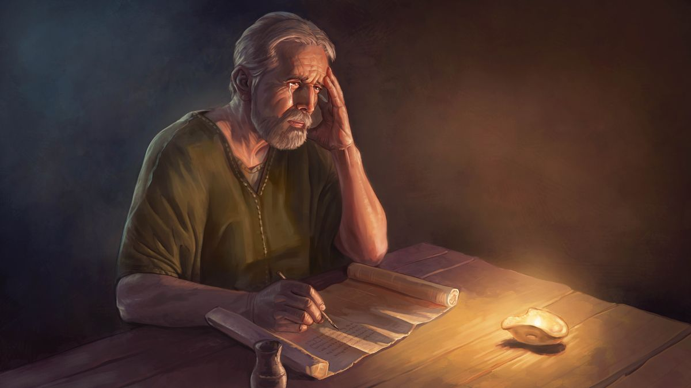

Nov 20, 2026

---

## INTRO [1 minuto]

"Huwag ka nang umiyak." "Be strong." "Move on na."

Madalas po nating marinig iyan kapag may di-magandang nangyari. Mabuti naman ang intensiyon ng nagsasabi. Pero paano kung mabigat talaga ang nangyari? Halimbawa, isang mahal natin sa buhay ang huminto sa paglilingkod kay Jehova. Mali bang malungkot tayo? Mahina ba ang pananampalataya natin kapag umiyak tayo?

Ngayong linggo po, sinimulan nating basahin ang Mga Panaghoy. Punô ng lungkot ang aklat na ito. At tapat na propeta ang sumulat nito, si Jeremias. Sa kaniya po natin makikita ang sagot. At iyan ang tema natin ngayong gabi: **Ang Normal na Reaksiyon Kapag May Di-magandang Nangyari.**

---

## VIDEO [3.5 minuto]

Kilalanin po muna natin ang aklat na ito. Pero bago natin panoorin ang introduksiyon nito, may dalawang tanong po tayong hahanapan ng sagot. Una, ano ang naramdaman ni Jeremias? Pangalawa, ano ang inasahan pa rin niya?

Panoorin po natin ang video na *Introduksiyon sa Mga Panaghoy.*

**VIDEO CUE: Introduksiyon sa Mga Panaghoy (2:46)**

Ano po ang naramdaman ni Jeremias? Nakita niya mismo ang pagkawasak ng Jerusalem, at napakalungkot niya. At ano ang inasahan pa rin niya? Umasa siyang maaawa si Jehova at ibabalik Niya sa dati ang bayan.

Lungkot at pag-asa. Tingnan po natin ang dalawang iyan sa mismong isinulat ni Jeremias.

---

## 1 — Lungkot na lungkot si Jeremias nang makita niyang nagdurusa ang mga taga-Jerusalem na hindi na naglilingkod kay Jehova [1.5 minuto]

Buksan po natin ang Panaghoy kabanata 2, bersikulo 11. Pansinin po kung gaano kalalim ang lungkot niya, at kung para kanino ito.

*[Basahin ang Panaghoy 2:11]*

!!! quote "Panaghoy 2:11"
    "Namumugto ang mga mata ko sa kaiiyak. Naghihirap ang kalooban ko. Nadurog ang puso ko, dahil sa pagbagsak ng anak na babae ng bayan ko, Dahil nanlulupaypay ang mga bata at mga sanggol sa mga liwasan ng bayan."

**==Lungkot na lungkot si Jeremias nang makita niyang nagdurusa ang mga taga-Jerusalem na hindi na naglilingkod kay Jehova.==**

Ano po ang natutuhan natin dito? Dalawa.

Una, normal ang malungkot. Tapat na propeta si Jeremias, pero sabi niya: **"Namumugto ang mga mata ko sa kaiiyak."** Kaya kapag may mahal tayong huminto sa paglilingkod kay Jehova at nalulungkot tayo, normal iyan.

Pangalawa, galing sa awa ang lungkot niya. Hindi nakinig sa kaniya ang mga kababayan niya. Pero tinawag pa rin niya silang **"anak na babae ng bayan ko."** Sabi ng talababa, malamang na nagpapahayag iyan ng **"awa o simpatiya."**

---

## IMAGE [0.5 minuto]

**IMAGE CUE: picture.jpg**

Ngayon naman po, tingnan natin ang larawan.

<figure markdown="span">
  { width="100%" }
  <figcaption>Si Jeremias na napapaluha na lang habang isinusulat ang aklat ng Mga Panaghoy sa isang balumbon.</figcaption>
</figure>

Ano po ba ang nakikita natin dito, mga kapatid at mga kaibigan? May luha sa pisngi ni Jeremias, at nakahawak ang kamay niya sa ulo. Pero nagsusulat pa rin siya.

At napansin n'yo po ba ang caption? Sabi po dito:

> **"Si Jeremias na napapaluha na lang habang isinusulat ang aklat ng Mga Panaghoy sa isang balumbon."**

Umiiyak ang isang tapat na propeta. Kaya hindi po kahinaan ng pananampalataya ang umiyak. At hindi lang lungkot ang isinulat niya. May pag-asa rin.

*Salamat po sa picture.*

---

## 2 — Umasa si Jeremias na manunumbalik sila kay Jehova, magpapakumbaba, mananalangin, at magsisisi [1.5 minuto]

Buksan po natin ang Panaghoy kabanata 2, bersikulo 19. Dito, ang Jerusalem ang kinakausap ni Jeremias. Pansinin po kung ano ang gusto niyang gawin ng bayan.

*[Basahin ang Panaghoy 2:19]*

!!! quote "Panaghoy 2:19"
    "Bumangon ka! Umiyak ka buong magdamag. Ibuhos mo ang puso mo na parang tubig sa harap ni Jehova. Itaas mo sa kaniya ang mga kamay mo alang-alang sa buhay ng mga anak mo, Na nanghihina sa kanto ng bawat kalye dahil sa taggutom."

Gusto niyang ibuhos nila ang puso nila **"sa harap ni Jehova."** Oo, **==umasa si Jeremias na manunumbalik sila kay Jehova, magpapakumbaba, mananalangin, at magsisisi.==**

Ano po ang itinuturo nito sa atin tungkol kay Jehova? **Iyon din ang gusto Niya.** Kahit sa mga inalis sa kongregasyon, sabi ng referensya natin, **"hindi kinukunsinti ni Jehova ang mga di-nagsisising nagkasala. Pero hindi niya sila sinusukuan. Gusto niya silang manumbalik."**

Gaya Siya ng ama sa ilustrasyon ni Jesus tungkol sa nawalang anak: ang ama ang unang lumapit.

Kaya kung may mahal tayo sa buhay na napalayo kay Jehova, huwag po nating isiping wala na siyang pag-asa. Gaya ni Jeremias, patuloy tayong umasa.

---

## PAGBUBULAY-BULAY [1 minuto]

May tanong po para sa ating pagbubulay-bulay: **==Kapag iniisip nating tayo ang dahilan kung bakit nakagawa ng maling desisyon ang iba, ano ang makakatulong sa atin?==**

Halimbawa, huminto sa paglilingkod kay Jehova ang isang anak. Malulungkot ang mga magulang, at normal iyon. Pero kung sisisihin nila ang sarili nila, sabi ng referensya natin, **"mapapabigatan lang sila. Ayaw ni Jehova na maramdaman nila iyon."**

Ano ang makakatulong? Tandaan na **"hindi tayo puwedeng magdesisyon para sa iba."** Ang inaasahan lang ni Jehova sa magulang, **"gawin mo ang buong makakaya mo. Ang anak mo ang mananagot sa mga desisyon niya, hindi ikaw."** At kung inaalala pa rin natin ang mga pagkakamali natin? **"Sabihin mo kay Jehova ang nararamdaman mo at humingi ng kapatawaran."**

---

## CONCLUSION [0.5 minuto]

Kaya ano po **ang normal na reaksiyon kapag may di-magandang nangyari**? Lungkot, at pag-asa. **Lungkot na lungkot si Jeremias**, pero **umasa** siyang **manunumbalik sila kay Jehova.** Kapag nalulungkot tayo dahil sa isang mahal sa buhay, huwag nating sisihin ang sarili natin sa desisyon niya. Sabihin natin kay Jehova ang nararamdaman natin, at patuloy tayong umasa. Dahil kung magsisikap siyang manumbalik kay Jehova, **"buong puso Niya siyang tatanggapin."**
